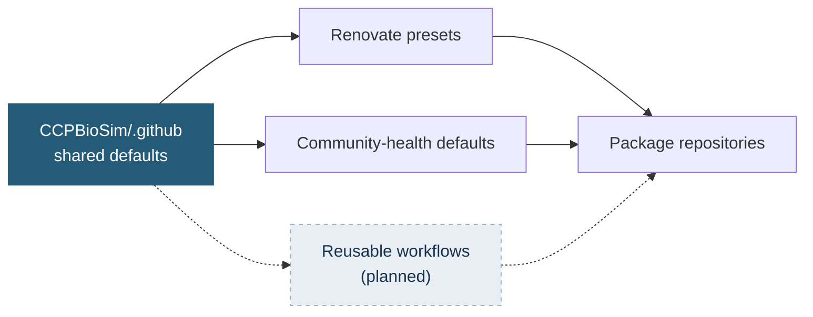

# CCPBioSim Shared Infrastructure

Shared defaults for CCPBioSim software projects: consistent dependency management, community-health files and, later, CI and release workflows.

**Centralising maintenance does not require centralising every decision.** Policy and repeated mechanics are shared. Scientific decisions stay in each package repository: dependency floors, supported Python versions, package paths, conda recipes and release exceptions.



## Status

| Area | Status |
|---|---|
| Renovate presets | Live |
| Pull request and issue templates | Live |
| `CONTRIBUTING.md`, `CODE_OF_CONDUCT.md`, `SECURITY.md` defaults | Live |
| Reusable CI, release and maintenance workflows | Built, not yet used by a repository |
| Workflow linting through pre-commit | Live |

## Using it

**Renovate.** Add a small `.github/renovate.json` to a repository:

```json
{
  "extends": [
    "github>CCPBioSim/.github//renovate/default",
    "github>CCPBioSim/.github//renovate/python"
  ],
  "assignees": ["<maintainer>"]
}
```

Changes here reach every repository on its next Renovate run. Runtime dependencies, dev tools and GitHub Actions are each grouped, and every pull request carries the `dependencies` label alongside `ci`, `python`, `production-deps` or `dev-dependencies`.

**Community-health files.** Nothing to do. GitHub inherits them for repositories without their own copy, and a local file always wins.

**Finding dependency updates across the organisation:**

```text
org:CCPBioSim is:pr is:open label:dependencies
```

## Workflows

Reusable workflows live in `.github/workflows/`. The folder is nested because this repository is itself called `.github`, so a caller writes the name twice:

```text
uses: CCPBioSim/.github/.github/workflows/<name>.yaml@<full commit SHA> # vX.Y.Z
```

Callers pin a full commit SHA with the version in a trailing comment, so Renovate can propose updates. A called workflow cannot have more permissions than its caller, so a caller grants what the table lists. Triggers, schedules and concurrency stay in the caller.

| Workflow | Purpose | Caller provides |
|---|---|---|
| `ci-test-python` | Run pytest on a Python and OS matrix and upload coverage | `package`, and `checks`, `statuses` and `pull-requests` write |
| `ci-test-conda` | The same for conda-based setups such as AiiDA plugins | `package`, `matrix`, `conda-packages`, and `checks` and `statuses` write |
| `ci-docs` | Build Sphinx docs with warnings as errors | Nothing required |
| `ci-pre-commit` | Run all pre-commit hooks | Nothing required |
| `ci-lowest-dependencies` | Test at the lowest versions that `pyproject.toml` allows | Lower bounds written as ranges |
| `ci-conda-build` | Build a conda recipe without uploading it | Nothing required |
| `ci-coveralls-finish` | Close a parallel Coveralls build | Run it after the coverage jobs |
| `release-prepare` | Check the version, update version files through a merged pull request, tag and create the GitHub release | `version`, `contents` and `pull-requests` write, and `AUTO_PR_MERGE` when `version-files` is used |
| `release-pypi` | Build from the release tag and publish to PyPI | `tag` and `PYPI_API_TOKEN` |
| `release-conda` | Build from the release tag and upload to Anaconda.org | `tag` and `ANACONDA_TOKEN` |
| `maintenance-license-year` | Open a pull request that updates the license year | `contents` and `pull-requests` write |

The `actions/cpp-coverage-upload` composite action turns gcov data into an lcov report and uploads it to Coveralls as a named parallel build, so C++ coverage combines with Python coverage. `ci-test-python` and `ci-test-conda` take `pre-test-command`, and `ci-docs` takes `pre-build-command`, for steps that must run first, such as downloading data or generating files. The release workflows also take `dry-run`, which runs every step except the ones that publish or change the repository.

Workflows in this repository are linted with `actionlint` and `zizmor` through pre-commit, which runs in CI through `ci-pre-commit`.

A pull request workflow in a package repository looks like this:

```yaml
jobs:
  test:
    uses: CCPBioSim/.github/.github/workflows/ci-test-python.yaml@<sha> # vX.Y.Z
    permissions:
      contents: read
      checks: write
      statuses: write
      pull-requests: write
    with:
      package: mypackage
  docs:
    uses: CCPBioSim/.github/.github/workflows/ci-docs.yaml@<sha> # vX.Y.Z
    permissions:
      contents: read
  pre-commit:
    uses: CCPBioSim/.github/.github/workflows/ci-pre-commit.yaml@<sha> # vX.Y.Z
    permissions:
      contents: read
```

## Defaults and policy

The defaults in the shared workflows are the organisation baseline. Checks that validate compatibility run the full supported Python set by default. Checks that validate presentation run one leg by default. A repository widens or narrows these explicitly in its own workflow, and each exception is its own choice to document.

| Workflow | Default Python | Default OS |
|---|---|---|
| `ci-test-python` | Full supported set | Linux |
| `ci-lowest-dependencies` | Full supported set | Linux |
| `ci-conda-build` | Full supported set | Linux |
| `ci-docs` | Latest only | Linux |
| `ci-pre-commit` | Latest only | Linux |

**Python versions.** The default set is the three newest stable CPython releases. A package's own `pyproject.toml` is the source of truth, so its matrix should match its `requires-python` and classifiers. A package with a narrower range overrides the default in its workflow. Adding a Python version waits until the package's dependencies support it, and dropping one is a deliberate, reviewed change.

**Operating systems.** The default is Linux only. Add macOS and Windows where a package has platform-specific behaviour, such as native code, numerical libraries or documented platform support. A scheduled workflow can run the wider matrix so pull requests stay quick.

---

<p align="center">
  <sub>Maintained by the CCPBioSim community.</sub>
</p>
