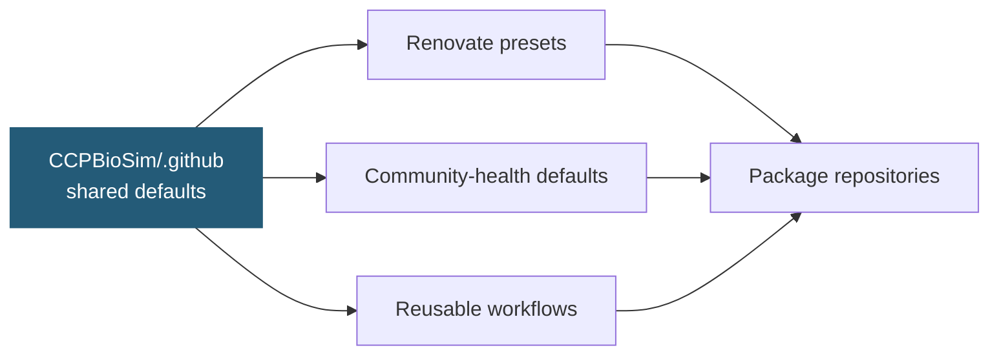

# CCPBioSim Shared Infrastructure

Shared defaults for CCPBioSim software projects: consistent dependency management, community-health files, and reusable CI, release and maintenance workflows.

**Centralising maintenance does not require centralising every decision.** Policy and repeated mechanics are shared. Scientific decisions stay in each package repository: dependency floors, supported Python versions, package paths, conda recipes and release exceptions.



## Status

| Area | Status |
|---|---|
| Renovate presets | Live |
| Pull request and issue templates | Live |
| `CONTRIBUTING.md`, `CODE_OF_CONDUCT.md`, `SECURITY.md` defaults | Live |
| Reusable CI, release and maintenance workflows | Live |
| Workflow linting through pre-commit | Live |

## Using it

**Renovate.** Add a small `.github/renovate.json` to a repository:

```json
{
  "extends": [
    "github>CCPBioSim/.github//renovate/default",
    "github>CCPBioSim/.github//renovate/python"
  ],
  "assignees": ["<maintainer>"]
}
```

Changes here reach every repository on its next Renovate run. Runtime dependencies, dev tools and GitHub Actions are each grouped, and every pull request carries the `dependencies` label alongside `ci`, `python`, `production-deps` or `dev-dependencies`.

**Community-health files.** Nothing to do. GitHub inherits them for repositories without their own copy, and a local file always wins.

**Finding dependency updates across the organisation:**

```text
org:CCPBioSim is:pr is:open label:dependencies
```

## Workflows

Reusable workflows live in `.github/workflows/`. The folder is nested because this repository is itself called `.github`, so a caller writes the name twice:

```text
uses: CCPBioSim/.github/.github/workflows/<name>.yaml@<full commit SHA> # X.Y.Z
```

Callers pin a full commit SHA with the version in a trailing comment, so Renovate can propose updates. A called workflow cannot have more permissions than its caller, so a caller grants what the table lists. Triggers, schedules and concurrency stay in the caller.

| Workflow | Purpose | Caller provides |
|---|---|---|
| `ci-test-python` | Run pytest on a Python and OS matrix, report coverage to Coveralls in a separate `Coverage` job, and optionally re-run the tests at the lowest versions that `pyproject.toml` allows (`lowest-dependencies-check`) | `package`, and `checks` and `statuses` write |
| `ci-test-conda` | The same for conda-based setups such as AiiDA plugins | `package`, `conda-packages`, and `checks` and `statuses` write |
| `ci-test-cpp-coverage` | Build C++ code with coverage instrumentation, run the tests against it, and upload the C++ report to Coveralls as a named parallel build | `build-command`, `filters`, and `checks` and `statuses` write. Close the build with `ci-coveralls-finish` |
| `ci-docs` | Build Sphinx docs with warnings as errors | Nothing required |
| `ci-pre-commit` | Run all pre-commit hooks | Nothing required |
| `ci-conda-build` | Build a conda recipe without uploading it | Nothing required |
| `ci-coveralls-finish` | Close a parallel Coveralls build | Run it after the coverage jobs |
| `release-prepare` | Check the version, update version files through a merged pull request, tag and create the GitHub release. `version-command` regenerates files that embed the version before the pull request opens, and `release-assets-command` with `release-assets` builds files from the tag and attaches them to the release | `version`, `contents` and `pull-requests` write, and `AUTO_PR_MERGE` when `version-files` is used. Optional `ZULIP_BOT_EMAIL`, `ZULIP_BOT_API_KEY` and `ZULIP_SITE` announce the release |
| `release-website` | Send the release metadata to the website repository | `version`, `tag` and `BUILD_TOKEN` |
| `release-pypi` | Build from the release tag and publish to PyPI | `tag` and `PYPI_API_TOKEN` |
| `release-conda` | Build from the release tag and upload to Anaconda.org | `tag` and `ANACONDA_TOKEN` |
| `maintenance-license-year` | Open a pull request that updates the license year | `contents` and `pull-requests` write |

Coverage is measured on one leg only, the first runner in `os` on `coverage-python-version`, or on the first entry of `python-versions` when that version is not in the list. That leg saves `coverage.xml` as an artifact, and the `Coverage` job uploads it to Coveralls, so the other legs run without the coverage overhead. Coverage is on by default in `ci-test-python` and off in `ci-test-conda`, so a conda-based caller sets `coverage: true` where it wants a report. A caller that runs a test workflow from a matrix gives each leg its own `coverage-flag` and closes the build with `ci-coveralls-finish`, so the reports have distinct names and combine in Coveralls.

`ci-test-cpp-coverage` measures C++ coverage for packages with compiled code. It installs the package, and any `conda-packages` the tests need, runs `build-command` to build the instrumented code, runs pytest, and uploads the C++ report through the `actions/cpp-coverage-upload` composite action. To report combined coverage, a caller sets `coverage-flag` on `ci-test-python` or `ci-test-conda`, runs `ci-test-cpp-coverage` alongside it, and closes the build with `ci-coveralls-finish` once both have finished. Do this on pull requests as well as on `main`, so Coveralls compares the same total. `ci-test-python` and `ci-test-conda` take `pre-test-command`, and `ci-docs` takes `pre-build-command`, for steps that must run first, such as downloading data or generating files. The release workflows also take `dry-run`, which runs every step except the ones that publish or change the repository.

Workflows in this repository are audited with `zizmor` through pre-commit, which runs in CI through `ci-pre-commit`.

A package repository's `pr.yaml` looks like this:

```yaml
name: Pull Request CI

on:
  pull_request:

permissions:
  contents: read

concurrency:
  group: pr-ci-${{ github.ref }}
  cancel-in-progress: true

jobs:
  unit:
    name: Unit
    uses: CCPBioSim/.github/.github/workflows/ci-test-python.yaml@<sha> # X.Y.Z
    permissions:
      contents: read
      checks: write
      statuses: write
    with:
      package: mypackage
      lowest-dependencies-check: true
  docs:
    name: Docs
    needs: unit
    uses: CCPBioSim/.github/.github/workflows/ci-docs.yaml@<sha> # X.Y.Z
    permissions:
      contents: read
  pre-commit:
    name: Pre-commit
    needs: unit
    uses: CCPBioSim/.github/.github/workflows/ci-pre-commit.yaml@<sha> # X.Y.Z
    permissions:
      contents: read
```

## Defaults and policy

The defaults in the shared workflows are the organisation baseline. Checks that validate compatibility run the full supported Python set by default. Checks that validate presentation run one leg by default. A repository widens or narrows these explicitly in its own workflow, and each exception is its own choice to document.

| Workflow | Default Python | Default OS |
|---|---|---|
| `ci-test-python` | Full supported set | Linux |
| `ci-test-conda` | Full supported set | Linux |
| `ci-conda-build` | Full supported set | Linux |
| `ci-docs` | Latest only | Linux |
| `ci-pre-commit` | Latest only | Linux |

**Python versions.** The default set is the three newest stable CPython releases. A package's own `pyproject.toml` is the source of truth, so its matrix should match its `requires-python` and classifiers. A package with a narrower range overrides the default in its workflow. Adding a Python version waits until the package's dependencies support it, and dropping one is a deliberate, reviewed change.

**Operating systems.** The default is Linux only, on `ubuntu-26.04`. Add macOS and Windows where a package has platform-specific behaviour, such as native code, numerical libraries or documented platform support. A scheduled workflow can run the wider matrix so pull requests stay quick.

## Where versions are controlled

| What | Where it lives | How it stays current |
|---|---|---|
| Shared-workflow pins in a package repository | the `uses:` lines of its workflows | the Renovate presets in `renovate/` |
| Python versions and the runner | defaults in the shared workflows | edit them here and release |
| Python dependencies, including AiiDA | the package's own `pyproject.toml` | tested at the newest version in range, and at the lowest with `lowest-dependencies-check` |
| Programs pip cannot install (GROMACS, PLUMED, AmberTools) | `conda-packages` in the package's test workflows | the repository |
| Conda recipe dependencies | read from `pyproject.toml` with `load_file_data` for pure-Python packages, or written in `conda-recipe/meta.yaml` for compiled or conda-first packages | the same as the Python dependencies, or the repository |

The runner label is written as a literal `runs-on` in some workflows, which Renovate updates, and in the `os` defaults, which it cannot see. When Renovate proposes a runner update, change the `os` defaults in the same pull request. `grep -rn "ubuntu-" .github` lists every place.

## Package repository layout

Every package repository uses the same set of caller workflows. Start from [Python-Template](https://github.com/CCPBioSim/Python-Template), which has the full set, and see CodeEntropy for a pip-based package and aiida-amber for a conda-based one.

| File | Runs | Calls |
|---|---|---|
| `pr.yaml` | On pull requests | The test workflow with coverage and `lowest-dependencies-check`, `ci-docs`, `ci-pre-commit`, and `ci-conda-build` if the package has a conda recipe |
| `weekly-tests.yaml` | Mondays | The test workflow with `lowest-dependencies-check` and `coverage: false`, often on a wider OS matrix |
| `coveralls-main.yaml` | On pushes to `main` | The test workflow with coverage, to build the baseline that pull requests are compared with |
| `weekly-docs.yaml` | Mondays | `ci-docs` |
| `release.yaml` | Manually, with `version` and `dry-run` | `release-prepare`, then `release-website`, `release-pypi` and `release-conda` as the package needs |
| `update-copyright-years-in-license-file.yaml` | On 1 January | `maintenance-license-year` |

Python versions come from the shared defaults, so the files list none unless `requires-python` is narrower. A conda-based package adds `conda-packages` for the programs pip cannot install, and a package that needs an extra matrix axis puts a normal `strategy.matrix` on the calling job. Workflows that only one package needs, such as regression tests or a Docker image build, stay in that repository next to these files.

Branch protection requires the checks from `pr.yaml`. Their names come from the job and workflow names, for example `Unit / Test (ubuntu-26.04, py3.14)`, so update the required checks when a matrix or job name changes.

**Dependency floors.** Set `lowest-dependencies-check: true` on the test job. After the normal tests, each leg reinstalls the lowest versions `pyproject.toml` allows for its direct dependencies and runs the tests again, so the floors are checked on every OS and Python version without extra jobs. Coverage is measured only in the normal run. `weekly-tests.yaml` runs it too, so no separate floors workflow is needed.

---

<p align="center">
  <sub>Maintained by the CCPBioSim community.</sub>
</p>
