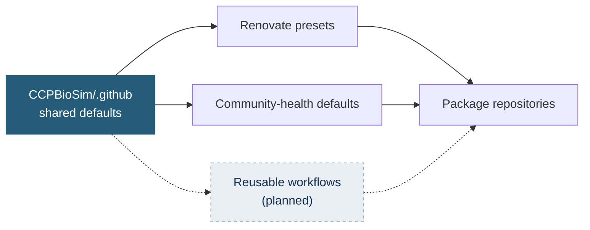

# CCPBioSim Shared Infrastructure

Shared defaults for CCPBioSim software projects: consistent dependency management, community-health files and, later, CI and release workflows.

**Centralising maintenance does not require centralising every decision.** Policy and repeated mechanics are shared. Scientific decisions stay in each package repository: dependency floors, supported Python versions, package paths, conda recipes and release exceptions.



## Status

| Area | Status |
|---|---|
| Renovate presets | Live |
| Pull request and issue templates | Live |
| `CONTRIBUTING.md`, `CODE_OF_CONDUCT.md`, `SECURITY.md` defaults | Live |
| [Onboarding checklist](ONBOARDING.md) | Live |
| Reusable CI and release workflows | Planned |
| Copier-based project template | Under evaluation |
| Branding consumption strategy | Under evaluation |

## Using it

**Renovate.** Add a small `.github/renovate.json` to a repository:

```json
{
  "extends": [
    "github>CCPBioSim/.github//renovate/default",
    "github>CCPBioSim/.github//renovate/python"
  ],
  "assignees": ["<maintainer>"]
}
```

Changes here reach every repository on its next Renovate run. Runtime dependencies, dev tools and GitHub Actions are each grouped, and every pull request carries the `dependencies` label alongside `ci`, `python`, `production-deps` or `dev-dependencies`.

> **Open questions:** the preset path syntax above has not yet been verified on a repository. Renovate's `rangeStrategy: widen` has also not been shown to preserve lower bounds for PEP 621 dependencies, so review every pull request that changes a lower bound.

**Community-health files.** Nothing to do. GitHub inherits them for repositories without their own copy, and a local file always wins.

**Finding dependency updates across the organisation:**

```text
org:CCPBioSim is:pr is:open label:dependencies
```

---

<p align="center">
  <sub>Maintained by the CCPBioSim community.</sub>
</p>
