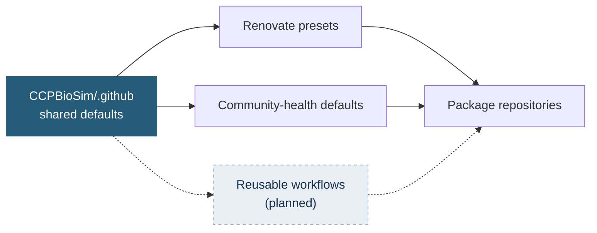

# CCPBioSim Shared Infrastructure

Shared defaults for CCPBioSim software projects: consistent dependency management, community-health files and, later, CI and release workflows.

**Centralising maintenance does not require centralising every decision.** Policy and repeated mechanics are shared. Scientific decisions stay in each package repository: dependency floors, supported Python versions, package paths, conda recipes and release exceptions.



## Status

| Area | Status |
|---|---|
| Renovate presets | Live |
| Pull request and issue templates | Live |
| `CONTRIBUTING.md`, `CODE_OF_CONDUCT.md`, `SECURITY.md` defaults | Live |
| [Onboarding checklist](ONBOARDING.md) | Live |
| Reusable CI and release workflows | Planned |

## Using it

**Renovate.** Add a small `.github/renovate.json` to a repository:

```json
{
  "extends": [
    "github>CCPBioSim/.github//renovate/default",
    "github>CCPBioSim/.github//renovate/python"
  ],
  "assignees": ["<maintainer>"]
}
```

Changes here reach every repository on its next Renovate run. Runtime dependencies, dev tools and GitHub Actions are each grouped, and every pull request carries the `dependencies` label alongside `ci`, `python`, `production-deps` or `dev-dependencies`.

**Community-health files.** Nothing to do. GitHub inherits them for repositories without their own copy, and a local file always wins.

**Finding dependency updates across the organisation:**

```text
org:CCPBioSim is:pr is:open label:dependencies
```

## Defaults and policy

The defaults in the shared workflows are the organisation baseline. Checks that validate compatibility run the full supported Python set by default. Checks that validate presentation run one leg by default. A repository widens or narrows these explicitly in its own workflow, and each exception is its own choice to document.

| Workflow | Default Python | Default OS |
|---|---|---|
| `ci-test` | Full supported set | Linux |
| `ci-lowest-dependencies` | Full supported set | Linux |
| `ci-conda-build` | Full supported set | Linux |
| `ci-docs` | Latest only | Linux |
| `ci-pre-commit` | Latest only | Linux |

**Python versions.** The default set is the three newest stable CPython releases. A package's own `pyproject.toml` is the source of truth, so its matrix should match its `requires-python` and classifiers. A package with a narrower range overrides the default in its workflow. Adding a Python version waits until the package's dependencies support it, and dropping one is a deliberate, reviewed change.

**Operating systems.** The default is Linux only. Add macOS and Windows where a package has platform-specific behaviour, such as native code, numerical libraries or documented platform support. A scheduled workflow can run the wider matrix so pull requests stay quick.

---

<p align="center">
  <sub>Maintained by the CCPBioSim community.</sub>
</p>
